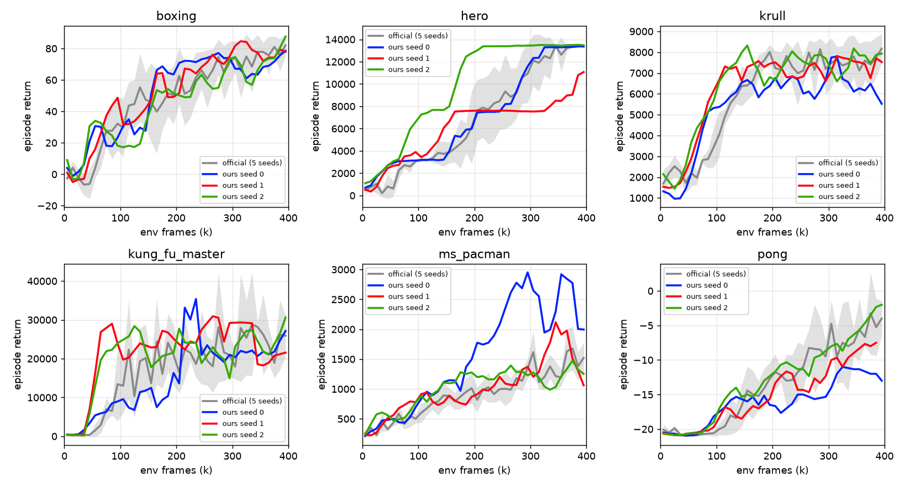

# DreamerV3 Reproduction — Week 1 (Reproduce)

_Last updated: 2026-11-24 03:23 KST · runs: 18 (finished 18, reproduced 4/6 games)_

**Paper:** Hafner et al., *Mastering Diverse Domains through World Models* (DreamerV3), [arXiv 2301.04104](https://arxiv.org/abs/2301.04104), Nature 2025.
**Code:** [danijar/dreamerv3](https://github.com/danijar/dreamerv3) at commit `e01491f` (Oct 2026), unmodified.

## 1. Goal

Confirm that the public DreamerV3 implementation, run with its **default (paper) hyperparameters**
on our own hardware, reaches the same scores as the official result files that ship with the repo
(`dreamerv3/scores/*.json.gz`, 5 seeds per task). We use the **Atari100k** benchmark because one
run finishes in ~2 hours on a single GPU, which makes a multi-game, multi-seed check possible within
a week.

## 2. What DreamerV3 does (short version)

DreamerV3 is a model-based RL agent with a fixed set of hyperparameters across domains:

1. **World model (RSSM).** An encoder maps pixels (64×64) to discrete latent codes (32 categoricals × 64 classes);
   a recurrent model predicts the next latent, the reward and the episode-continuation flag.
   Loss = reconstruction + reward + continue + dynamics/representation KL with free bits (1 nat) and KL balancing.
2. **Actor–critic trained in imagination.** From replayed states the world model dreams 15-step trajectories;
   the critic regresses λ-returns and the actor maximises them with an entropy bonus (3e-4).
3. **Robustness tricks that remove per-domain tuning:** `symlog` transform of inputs/targets, two-hot
   discrete regression for reward and value heads, percentile-based return normalisation,
   unimix (1%) on categoricals, and adaptive gradient clipping.

The repo defaults (`dreamerv3/configs.yaml`) correspond to the paper's **200M-parameter** model;
for Atari100k it uses `train_ratio=256`, one env, 110k agent steps (= 440k frames incl. the 400k budget).

## 3. Setup used here

| item | value |
|---|---|
| GPU | 1× NVIDIA RTX 5090 (32 GB, Blackwell), ~17 GB used per run |
| OS / driver | Ubuntu 20.04, driver 570.181 (CUDA 12.8) |
| Python | 3.11 (dedicated conda env `dreamerv3`) |
| JAX | `jax[cuda12]==0.6.2` (see note below) |
| Env packages | `ale_py==0.9.0`, `autorom`, `crafter`, `dm_control` |
| Throughput | ≈3.1 gradient updates/s (batch 16×64), ≈13 env steps/s at steady state |
| Wall-clock | ≈2.3 h per Atari100k run |
| Env protocol | 18 actions, no no-op starts, sticky actions off (`--env.atari100k.actions all --env.atari100k.noops 0`), see 3.1 |
| Runs | 6 games × 3 seeds = 18 runs (Pong, Boxing, Hero, Krull, Kung-Fu Master, Ms. Pac-Man) |

Exact package versions: [`env/requirements-lock.txt`](https://github.com/ChungEunho/dreamerv3-reproduce/blob/main/env/requirements-lock.txt).

### Install notes / pitfalls we hit

- The pinned `jax[cuda12]==0.4.33` in `requirements.txt` does not support Blackwell GPUs (sm_120).
  The latest JAX (0.10) breaks the repo (`jax.jit` positional arguments were removed:
  `TypeError: jit() takes from 0 to 1 positional arguments but 5 were given`).
  **`jax[cuda12]==0.6.2` + `chex<0.1.90`** works without touching the code.
- `nvidia-cuda-nvcc-cu12<=12.2` from `requirements.txt` must be dropped (Blackwell needs ≥12.8).
- Python output is block-buffered when piped to a log; set `PYTHONUNBUFFERED=1`.
- JAX preallocates ~75% of GPU memory by default. We run with `--jax.prealloc False`
  (`XLA_PYTHON_CLIENT_PREALLOCATE=false`) so the shared GPU is not held hostage.

### 3.1 Env protocol: match the one that produced the official scores

The official score file `atari100k-dreamerv3.json.gz` was added in upstream commit `2411f7d` (April 2024).
The Atari100k env in that version used **all 18 actions** and **no no-op starts**
(`actions: all`, `noops: 0`). The code was rewritten in December 2024 (`f8817c4`), and today's default is
`actions: needed` (the minimal action set, e.g. 6 for Pong) with `noops: 30`.

This matters. Our first Pong run used today's defaults and reached **+13.5** over the last 10 % of the budget,
far *above* the official range (−9.2 … −1.3); a smaller action set makes the task easier. We kept that run as
an ablation (`logdir_ablation/atari100k_pong_s0_minact`) and ran all 18 reported runs with the old protocol
by passing `--env.atari100k.actions all --env.atari100k.noops 0`. Everything else (model size, batch 16×64,
replay, `train_ratio=256`, 110k agent steps) is identical between the two configs.

## 4. Results

**Metric.** Episode return of the training episodes, as logged by the repo (`scores.jsonl`).
"Final score" = mean return over the **last 10 % of the 400k-frame budget** (frames 360k–400k), computed the
same way for our runs and for each of the 5 official seeds.

**Verdict rules** (fixed before the runs finished, not tuned afterwards):

- *Per seed:* reproduced if the final score lies inside the official 5-seed range `[min, max]` widened by one
  official std; otherwise "below" / "above official range".
- *Per game* (over our 3 seeds): reproduced if (1) the mean of our final scores passes the same range test and
  (2) our mean learning curve stays inside the official envelope (per-bin min/max ± std, 40 bins) for at least
  75 % of the bins ("curve in band"). "final ok, curve differs" means (1) holds but (2) does not.

Paper Table 9 is shown next to the official file mean. They are close but not identical
(Krull 8171 vs 7684, Kung-Fu Master 25900 vs 23302); we test against the per-seed file because it gives a spread.
Gamer-normalised score = (agent − random) / (human − random), with random/human from Table 9.

### Summary

**DreamerV3 reproduces on Atari100k.** With the env protocol of the official scores, our 18 runs (6 games × 3 seeds)
land where the official 5 seeds land:

- **4 of 6 games pass both tests** (final score and learning curve): Boxing, Krull, Kung-Fu Master, Pong.
- **14 of 18 individual seeds** have a final score inside the official range (± 1 std).
- **Every game has at least 2 of 3 seeds inside the official range.** The 4 misses go in both directions
  (3 below, 1 above), so there is no systematic bias.
- **6-game gamer-normalised score:** ours **230 %** mean / **71 %** median, official file 240 % / 75 %,
  paper Table 9 253 % / 81 % (same 6 games; not comparable to the 26-game numbers of Figure 1a).

The two games that miss the per-game test miss because of one seed each:

- **Hero** (final mean below range): seeds 0 and 2 reach the same ~13.4k plateau as all official seeds
  (13373 and 13465). Seed 1 stays on a ~7.5k plateau and only reaches the 13k level at ~390k frames, so its
  360k–400k average is 9917. The official range is very narrow (std 96) because all 5 official seeds hit the
  plateau before 360k frames, which makes this verdict sensitive to *when* a seed gets there.
- **Ms. Pac-Man** (final mean in range, curve differs): seeds 1 and 2 follow the official curves closely
  (1297 and 1356). Seed 0 learns much faster from ~180k frames and ends at 2394, above every official seed.

The per-seed misses of Pong seed 0 (−12.0) and Krull seed 0 (6143) are within normal seed spread: the other two
seeds of each game are in range and the 3-seed means pass.

#### Per game (verdict over our finished seeds)

| task | seeds done | ours mean ± std | paper Table 9 | official file mean (min–max, 5 seeds) | gamer-norm ours / paper | curve in band | verdict |
|---|---|---|---|---|---|---|---|
| boxing | 3/3 | 79.5 ± 1.6 | 82 | 79.4 (70.2–85.0) | 662.7% / 683.3% | 90% | **reproduced** |
| hero | 3/3 | 12251.5 ± 1651.4 | 13354 | 13344.3 (13190.7–13465.0) | 37.7% / 41.4% | 70% | **below official range** |
| krull | 3/3 | 7150.2 ± 714.3 | 8171 | 7683.5 (7365.0–8154.3) | 519.9% / 615.4% | 75% | **reproduced** |
| kung_fu_master | 3/3 | 23658.4 ± 2282.4 | 25900 | 23301.7 (18766.7–29533.3) | 104.1% / 114.1% | 82% | **reproduced** |
| ms_pacman | 3/3 | 1682.4 ± 503.9 | 1521 | 1525.8 (1206.7–1807.5) | 20.7% / 18.3% | 70% | **final ok, curve differs** |
| pong | 3/3 | -7.5 ± 3.8 | -4 | -4.2 (-9.2–-1.3) | 37.5% / 47.2% | 85% | **reproduced** |

#### Per seed

| task | seed | progress | ours (last 10%) | official mean ± std (min–max) | curve in band | verdict |
|---|---|---|---|---|---|---|
| boxing | 0 | 100% | 78.8 | 79.4 ± 5.7 (70.2–85.0) | 88% | **reproduced** |
| boxing | 1 | 100% | 78.0 | 79.4 ± 5.7 (70.2–85.0) | 95% | **reproduced** |
| boxing | 2 | 100% | 81.8 | 79.4 ± 5.7 (70.2–85.0) | 82% | **reproduced** |
| hero | 0 | 100% | 13372.8 | 13344.3 ± 96.5 (13190.7–13465.0) | 90% | **reproduced** |
| hero | 1 | 100% | 9916.7 | 13344.3 ± 96.5 (13190.7–13465.0) | 70% | **below official range** |
| hero | 2 | 100% | 13465.0 | 13344.3 ± 96.5 (13190.7–13465.0) | 61% | **reproduced** |
| krull | 0 | 100% | 6143.3 | 7683.5 ± 356.4 (7365.0–8154.3) | 70% | **below official range** |
| krull | 1 | 100% | 7725.0 | 7683.5 ± 356.4 (7365.0–8154.3) | 78% | **reproduced** |
| krull | 2 | 100% | 7582.2 | 7683.5 ± 356.4 (7365.0–8154.3) | 70% | **reproduced** |
| kung_fu_master | 0 | 100% | 23492.0 | 23301.7 ± 4398.5 (18766.7–29533.3) | 88% | **reproduced** |
| kung_fu_master | 1 | 100% | 20950.0 | 23301.7 ± 4398.5 (18766.7–29533.3) | 72% | **reproduced** |
| kung_fu_master | 2 | 100% | 26533.3 | 23301.7 ± 4398.5 (18766.7–29533.3) | 81% | **reproduced** |
| ms_pacman | 0 | 100% | 2394.3 | 1525.8 ± 240.7 (1206.7–1807.5) | 40% | **above official range** |
| ms_pacman | 1 | 100% | 1296.9 | 1525.8 ± 240.7 (1206.7–1807.5) | 82% | **reproduced** |
| ms_pacman | 2 | 100% | 1356.1 | 1525.8 ± 240.7 (1206.7–1807.5) | 85% | **reproduced** |
| pong | 0 | 100% | -12.0 | -4.2 ± 2.7 (-9.2–-1.3) | 74% | **below official range** |
| pong | 1 | 100% | -7.8 | -4.2 ± 2.7 (-9.2–-1.3) | 89% | **reproduced** |
| pong | 2 | 100% | -2.8 | -4.2 ± 2.7 (-9.2–-1.3) | 81% | **reproduced** |




Per-task figures are in [`docs/assets/`](https://github.com/ChungEunho/dreamerv3-reproduce/tree/main/docs/assets)
(grey = official mean ± std over 5 seeds, colored = our seeds).

## 5. How to reproduce

```bash
# 1. environment
conda create -n dreamerv3 python=3.11 -y
conda activate dreamerv3
pip install "jax[cuda12]==0.6.2" "chex<0.1.90"
pip install -r dreamerv3/requirements.txt --no-deps   # or env/requirements-lock.txt for exact versions
pip install crafter dm_control matplotlib pandas pyyaml

# 2. one run (paper defaults + the env protocol of the official scores), on GPU 2
scripts/launch.sh 2 atari100k_pong_s0 --configs atari100k --task atari100k_pong --seed 0 \
    --env.atari100k.actions all --env.atari100k.noops 0

# 3. (optional) run the whole job list in scripts/queue.txt sequentially
tmux new -d -s wA "scripts/queue.sh A 2 0 1 3"   # worker A, GPU preference order
tmux new -d -s wB "scripts/queue.sh B 0 1 3 2"   # worker B (max 2 workers = max 2 GPUs)

# 4. compare with the official scores and rebuild this page
python scripts/analyze.py --logdir logdir --out docs
```

`scripts/launch.sh` refuses to start if the chosen GPU is busy. `scripts/queue.sh` workers only take a GPU that is completely idle, coordinate through lock files, blacklist a GPU that
dies with a CUDA error and resumes the run from its checkpoint on another idle GPU.

## 6. Notes & limitations

- **Agent code version.** The official scores come from the April 2024 code; we ran the current code
  (`e01491f`, after the December 2024 rewrite) with the old env protocol. This difference cannot be removed
  without porting the old code to a JAX version that runs on Blackwell GPUs, so part of any remaining gap
  may come from the code version rather than from seed noise.
- **Only 6 of the 26 Atari100k games.** Per-game curves and scores (paper Figure 13 / Table 9) can be compared;
  the 26-game aggregate (gamer mean/median, Figure 1a) cannot.
- **3 seeds vs 5 official seeds.** A single seed often lands outside the official 5-seed range on these
  high-variance tasks, so the per-game verdict is the main result and per-seed misses are expected.
- **Replay ratio.** The paper's Table 2 lists a replay ratio of 128 for Atari100k, while both the old and the
  current repo configs use `train_ratio=256`. We kept the repo value, which is what produced the official file.
- Only Atari100k was run: Crafter and DMC need roughly 25–50 h per run on one GPU, which did not fit the week.
- Scores are from training episodes (sticky actions off, 1 env), matching how the official files were produced.

